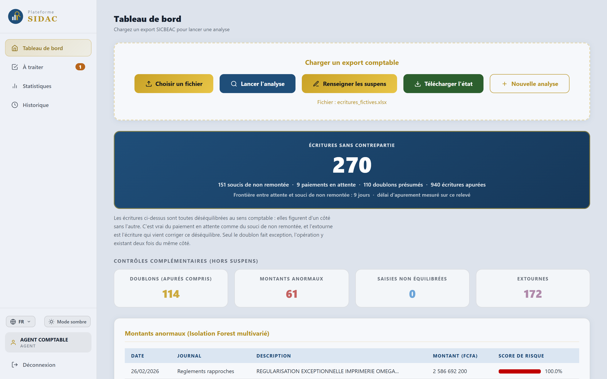
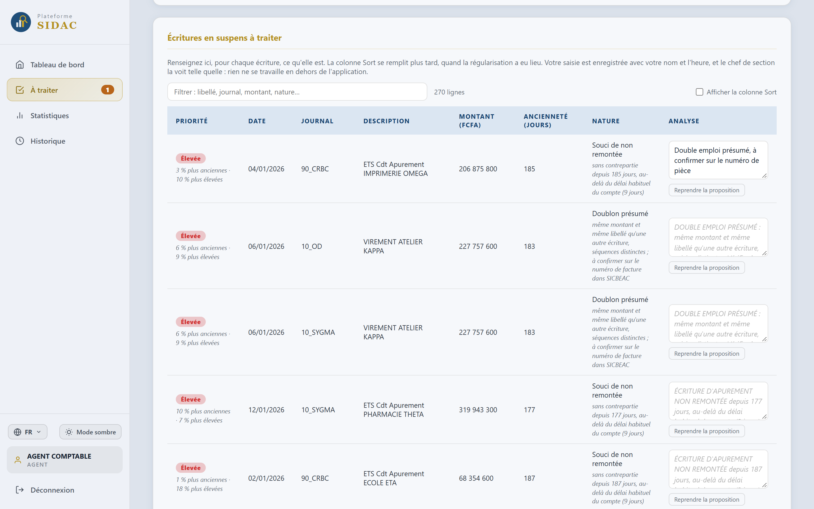
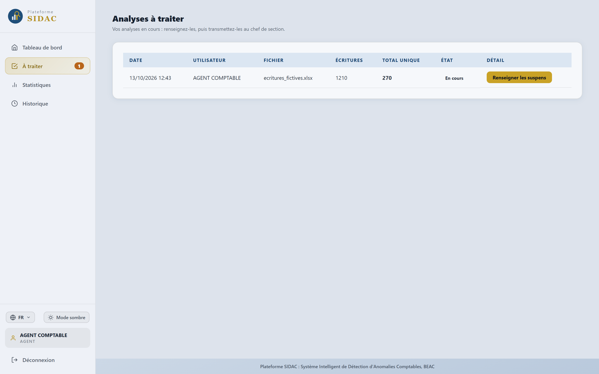
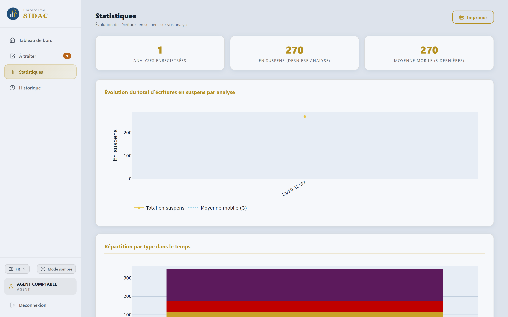

# SIDAC, détection automatique d'anomalies comptables

Pendant mon stage, j'ai vu une comptable pointer à la main un relevé de plus de
14 000 lignes. Elle cherchait les écritures qui ne tombaient pas juste. Ça lui
prenait plus d'une journée. J'ai passé mon stage à essayer de lui faire gagner
cette journée.

SIDAC veut dire Système Intelligent de Détection d'Anomalies Comptables. C'est
une application web qui lit un relevé de compte, retrouve les écritures qui
n'ont pas de contrepartie, signale les montants inhabituels, et soumet tout ça
au comptable, qui garde le dernier mot.

C'est mon projet de fin d'études (Bachelor Intelligence Artificielle et Big
Data, KEYCE Douala). Je l'ai réalisé pendant un stage à l'agence de Douala de la
Banque des États de l'Afrique Centrale.

## Important : aucune donnée réelle dans ce dépôt

Les écritures d'une banque sont confidentielles. Elles ne sortent pas de
l'agence, et elles ne sont pas ici.

Tout ce que vous voyez dans ce dépôt est inventé. Le fichier d'essai, les
montants, les noms de sociétés (ETS DELTA, GARAGE ZETA, ATELIER KAPPA), les
dates : j'ai tout fabriqué moi-même avec un générateur. Les captures d'écran ont
été prises avec ce fichier inventé, et avec lui seul.

La seule chose que j'ai gardée du vrai, c'est la forme du fichier d'entrée, pour
que l'application sache le lire. Une forme de fichier n'est pas une donnée.

Attention à ne pas mélanger les deux séries de chiffres qui apparaissent plus
bas :

* 14 324 écritures et 83,9 % d'accord : ce sont mes vraies mesures, faites dans
  l'agence. Je les cite d'après mon mémoire, qui a été soutenu en public. Ce
  sont des totaux, on ne peut remonter à aucune opération ni à personne.
* 1 210 écritures et 940 apurées : c'est le fichier d'essai inventé, celui qui
  est livré avec le dépôt et qui sert aux captures.

## Le problème que j'ai voulu résoudre

Un suspens, c'est une écriture qui ne trouve pas sa contrepartie. Pour la
retrouver, le comptable lit le relevé ligne par ligne et apparie les montants à
la main.

Le vrai souci, c'est qu'il y a trois causes différentes derrière un suspens, et
qu'elles se ressemblent à l'œil : un doublon de saisie, un paiement encore en
attente, ou une écriture qui n'est jamais remontée. Tant qu'on ne les sépare
pas, on ne sait pas quoi corriger.

## Ce que fait l'application

1. Elle lit le relevé. Elle accepte deux formats de fichier et les reconnaît
   toute seule. Si la structure ne correspond à aucun des deux, elle refuse le
   fichier au lieu de l'interpréter de travers.
2. Elle apparie les écritures par montant et par libellé, puis elle classe ce
   qui reste dans les trois causes.
3. Elle signale les montants inhabituels avec un algorithme d'apprentissage non
   supervisé (Isolation Forest).
4. Pour chaque signalement, elle écrit en toutes lettres pourquoi elle le fait.
   Le comptable lit la raison, puis il accepte ou il refuse.
5. Elle fait circuler le résultat dans la hiérarchie du service : l'agent
   renseigne, le chef de section vise, le chef de service valide. Chaque visa
   est horodaté.
6. Elle produit l'état final en Excel, dans le format que le service utilisait
   déjà.



*Le tableau de bord après une analyse. Fichier d'essai inventé.*

## Chaque signalement s'explique

C'est pour moi le point le plus important du projet. L'application ne renvoie
jamais un score tout seul. Pour chaque écriture, elle dit pourquoi elle la
signale, et elle propose une phrase que le comptable peut reprendre, corriger ou
refuser.



*"Sans contrepartie depuis 185 jours, au-delà du délai habituel du compte
(9 jours)". Le délai de référence n'est pas fixé à l'avance, il est calculé sur
le relevé qu'on charge. Les noms de sociétés qu'on voit ici sont inventés.*

## Les résultats

Ces chiffres sont les vrais, mesurés dans l'agence sur le relevé de janvier à
juin 2026, qui comptait 14 324 écritures.

| Ce que j'ai mesuré | Résultat |
|---|---|
| Durée du traitement complet | moins d'une minute (entre 37 et 59 secondes) |
| Accord avec la comptable sur le statut d'apurement | 83,9 % |
| Accord avec la comptable sur la contrepartie trouvée | 96,9 % |
| Écritures apurées | 1 270 (8,9 %) |
| Écritures sans contrepartie | 13 050 (91,1 %) |

Un mot sur les 83,9 %. Un accord total ne serait pas un meilleur résultat. Ça
voudrait dire que l'application se contente de répéter ce que la comptable
voyait déjà. L'écart, c'est justement là où la discussion commence, et c'est
pour ça qu'elle peut refuser chaque proposition.

## Ce qui a guidé mes choix

L'application ne décide rien à la place du comptable. Elle trie, et elle
explique. Aucune écriture n'est corrigée d'office, aucune proposition n'est
enregistrée sans qu'une personne l'ait validée. Un modèle qui a raison tout seul
ne sert à rien s'il n'y a pas moyen de le contredire.

C'est aussi pour ça que j'ai calqué le circuit de validation sur la hiérarchie
qui existait déjà, au lieu d'en inventer une autre.





*Les statistiques d'un arrêté au suivant : ce qui se referme, ce qui traîne, et
le délai au-delà duquel une écriture n'est plus une attente normale.*

## Essayer l'application

```bash
git clone https://github.com/Chris-oliver01/sidac.git
cd sidac
pip install -r requirements.txt
python app.py
```

Ouvrez ensuite http://127.0.0.1:5000.

Au premier démarrage, l'application crée le compte `admin@sidac.local` et écrit
son mot de passe, tiré au hasard, dans un fichier `PREMIERE_CONNEXION.txt`. Elle
en demande aussitôt un nouveau. Il n'y a aucun mot de passe dans le code.

Pour voir l'application travailler, chargez le fichier d'essai :

```
jeu_essai/ecritures_fictives.xlsx
```

Il contient 1 210 écritures inventées. Je l'ai construit pour qu'on voie
quelque chose : des écritures qui s'apurent deux à deux, des doublons, des
paiements en attente, des écritures jamais remontées, et quelques montants
vraiment hors norme. L'analyse en retient 940 apurées et 270 sans contrepartie.

Par défaut, les données sont rangées dans un fichier SQLite local. Pour utiliser
une base PostgreSQL partagée entre plusieurs postes, il suffit de renseigner la
variable d'environnement `SIDAC_BDD`.

## Ce que j'ai utilisé

Python, Flask, SQLAlchemy, pandas, NumPy, scikit-learn, openpyxl, bcrypt,
Plotly.

## Auteur

BEMBA BEMBA Jean Chris-Oliver, Bachelor Intelligence Artificielle et Big Data,
KEYCE Douala.
[Mon profil LinkedIn](https://www.linkedin.com/in/chris-oliver-bemba-a04734325/)

Publié avec l'accord de mon encadreur de stage.
